# Web 界面

浏览器里点几下就能转录，不用敲命令。同一套引擎，同一个 `pipeline.py`，CLI 能做的这里都能做。

```bash
pip install -r requirements-web.txt
python web/server.py
```

会自动打开 <http://127.0.0.1:8787>。

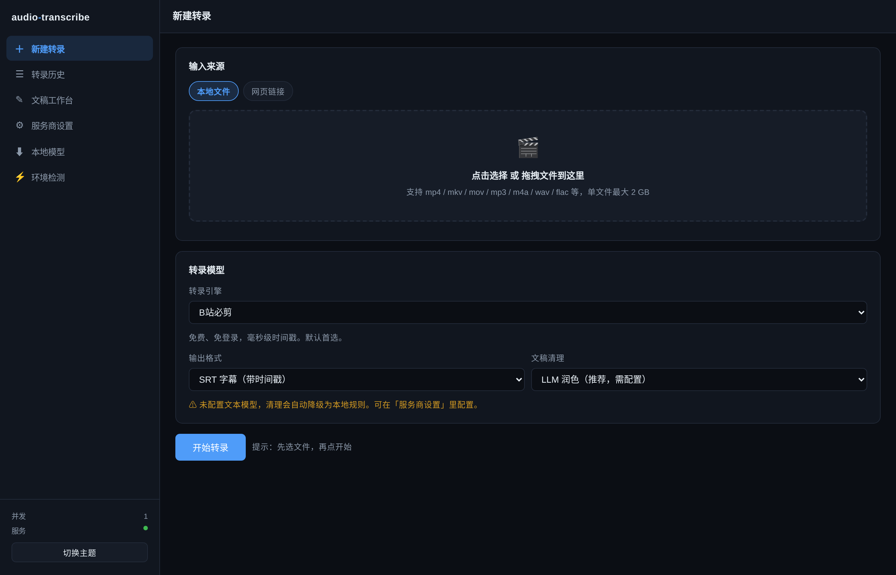

---

## 一、为什么值得用

| 痛点 | CLI | Web |
|---|---|---|
| 记参数 | 要背 `--engine` `--clean` `--format` | 下拉框选 |
| 看进度 | 一行行 stderr 滚动 | 四阶段进度条 + 可滚动日志 |
| 改错字 | 用编辑器改文件 | 边听边点时间戳跳转，就地编辑 |
| 找重点 | 通读全文 | 生成总结 / 对着文稿提问，答案带 `[00:12:34]` 可点击 |
| 校对效果 | 重新跑一遍对比 | 润色结果并列显示，不覆盖原文 |
| 环境问题 | 自己看报错、自己 pip | 一键检测 + 一键修复 |

---

## 二、五项功能

### 1. 在线链接转录

贴链接 → 选引擎 → 开始。支持 B站、YouTube、微博、抖音、小红书、快手等（完整列表见 [`references/platforms.md`](../references/platforms.md)）。

小红书、快手**必须**配 Cookie，否则平台直接拒绝。在「服务商设置 → 平台 Cookie」里填。

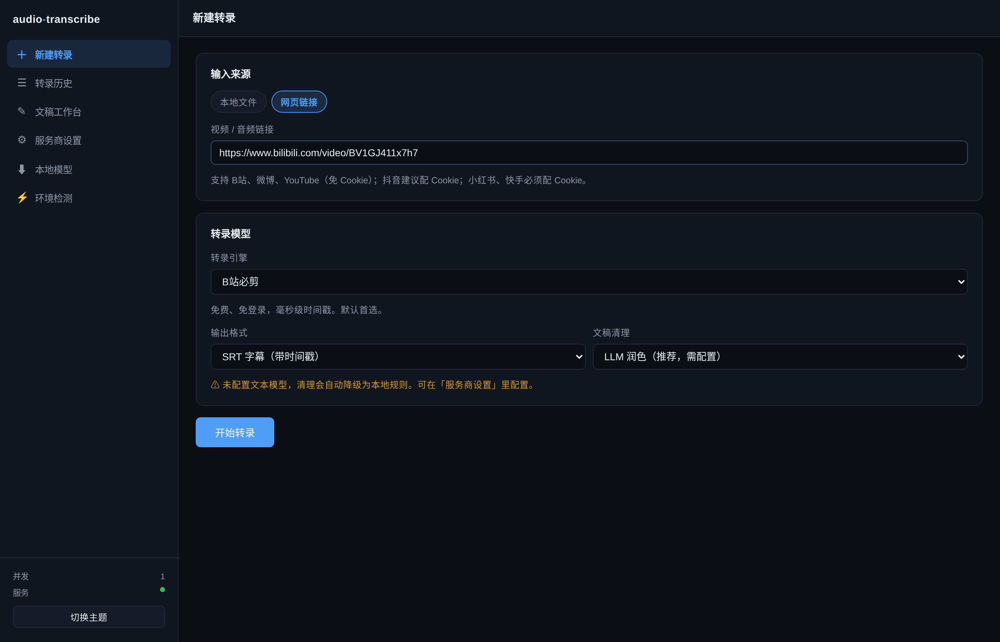

提交后进四阶段进度条，日志实时滚动，随时可以取消：

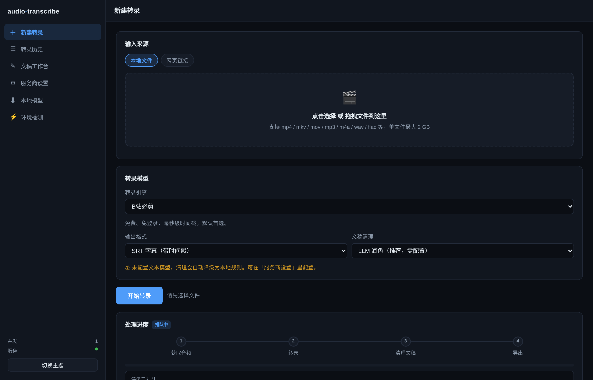

### 2. 本地音视频转录

点选或拖拽文件，最多一次拖多个。支持 `mp4 / mkv / mov / avi / webm / flv / ts / mp3 / m4a / wav / flac / aac / ogg / opus / wma`。

上限默认 2 GB，可用 `AT_MAX_UPLOAD_MB` 调整。视频只抽音轨，不占额外空间。

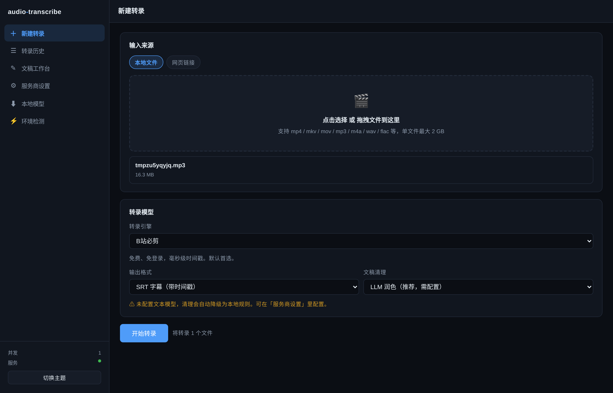

### 3. 转录模型服务商配置

六个引擎，界面上直接选：

| 引擎 | 需要 key | 有时间戳 | 说明 |
|---|---|---|---|
| B站必剪 | 否 | ✅ | 免费免登录，**默认首选** |
| 剪映 | 否 | ✅ | 免费，但依赖第三方签名服务 |
| OpenAI Whisper 兼容 | 是 | ✅ | 任意兼容 `/audio/transcriptions` 的服务 |
| 硅基流动 | 是 | ❌ | Qwen3-ASR，只有整段文本 |
| faster-whisper | 否 | ✅ | 本地推理，跨平台 |
| MLX whisper | 否 | ✅ | 本地推理，**仅 Apple Silicon** |

MLX 在非 macOS 环境会**禁用并显示原因**，不会让你点了才发现跑不了。

### 4. 文本处理服务商配置

润色、总结、问答都走这里配的 OpenAI 兼容服务。预设了 DeepSeek / 硅基流动 / OpenAI / 本地 Ollama，也能自己加。

每个服务商都有「测试」按钮，直接打一次真实请求确认能不能用。

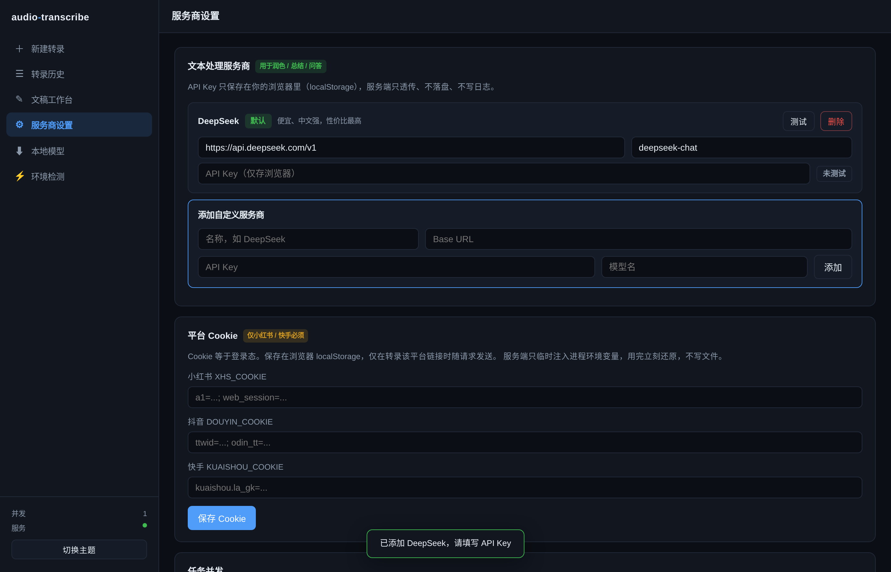

### 5. 依赖自动安装与检测修复

「环境检测」页会检查 11+ 项，分三级处理：

- **L1 只读检测**：Python 版本、ffmpeg/ffprobe、pip 包、yt-dlp 新旧、磁盘空间
- **L2 一键修复**：pip 装依赖、升级 yt-dlp、下载 ffmpeg 静态二进制到 `~/.audio-transcribe/bin/`
- **L3 只给命令**：需要系统权限的（`apt` / `brew` / `winget`），**绝不执行 sudo**

ffmpeg 静态二进制下载到用户目录，不需要 root。

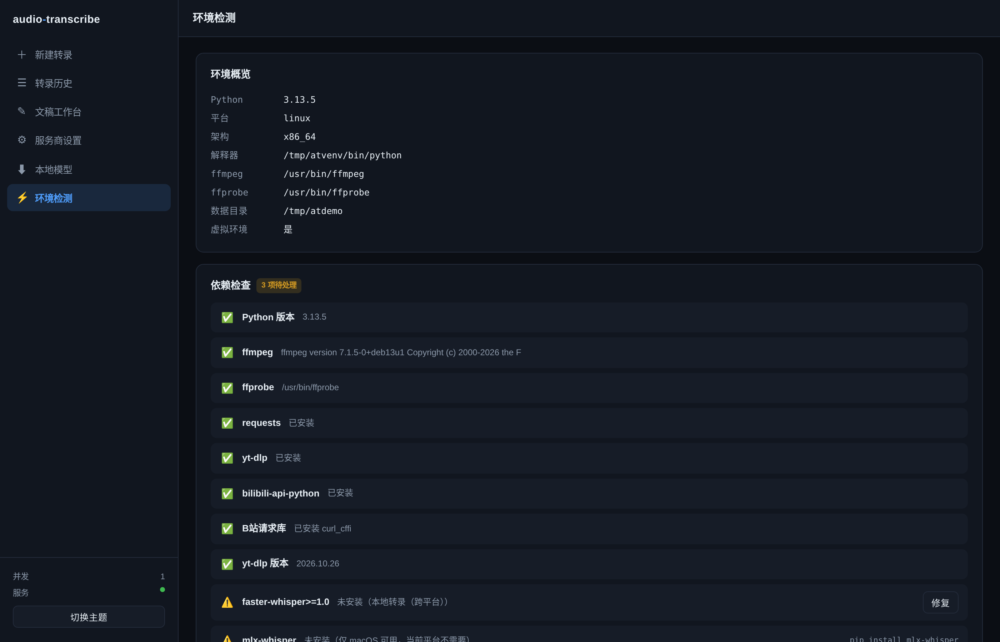

---

## 三、Key 存在哪里

**API Key 只存在你的浏览器 localStorage，服务端不落盘、不写日志。**

请求流程：

```
浏览器 localStorage  ──►  请求头/表单  ──►  服务端内存  ──►  第三方 API
                                              │
                                              └─ 用完即弃，不写任何文件
```

服务端只在处理该次请求期间持有 key，任务结束就丢。`~/.audio-transcribe/` 里只有任务历史（`tasks.json`）和转录产物，**没有任何密钥**。

Cookie 同理：只在你转录该平台链接时随请求发送，服务端临时注入进程环境变量，`pipeline.py` 的 `finally` 里立刻还原。

> 如果服务部署在多人共用的机器上，请注意：浏览器 localStorage 是按域名隔离的，但同一台机器的同一个浏览器配置文件是共享的。公用电脑建议用完清一下浏览器数据。

---

## 四、长文稿问答怎么不炸

一份 3 小时访谈能到 5 万字，塞不进任何模型的上下文。所以分三级：

| 长度 | 策略 |
|---|---|
| ≤ 8,000 字 | 全文直接送 |
| 8,000 – 50,000 字 | **BM25 检索**出最相关的 30 段再送 |
| > 50,000 字 | 先逐段摘要压缩，再基于摘要回答 |

BM25 是纯 Python 实现的（约 40 行），中文按字符 bigram 切分。不引入向量库，不需要 embedding key，零额外依赖。

回答里会带 `[00:12:34]` 标记，点击直接跳到播放器对应位置。

---

## 五、本地模型

「本地模型」页可以下载：

| 模型 | 大小 | 平台 |
|---|---|---|
| whisper large-v3-turbo (faster-whisper) | 1.6 GB | 全平台 |
| whisper large-v3 (faster-whisper) | 3.0 GB | 全平台 |
| whisper medium (faster-whisper) | 1.5 GB | 全平台 |
| whisper large-v3-turbo (MLX) | 1.6 GB | 仅 Apple Silicon |
| Qwen3-ASR 0.6B (MLX) | 340 MB | 仅 Apple Silicon |

下载源默认 `hf-mirror.com`（国内可直连），可在页面上改成 `huggingface.co` 或其他镜像。

模型存在 `~/.audio-transcribe/models/`，下载完就能断网转录。

平台不适用的模型会直接标灰并写明原因，不会让你点了才发现跑不了：

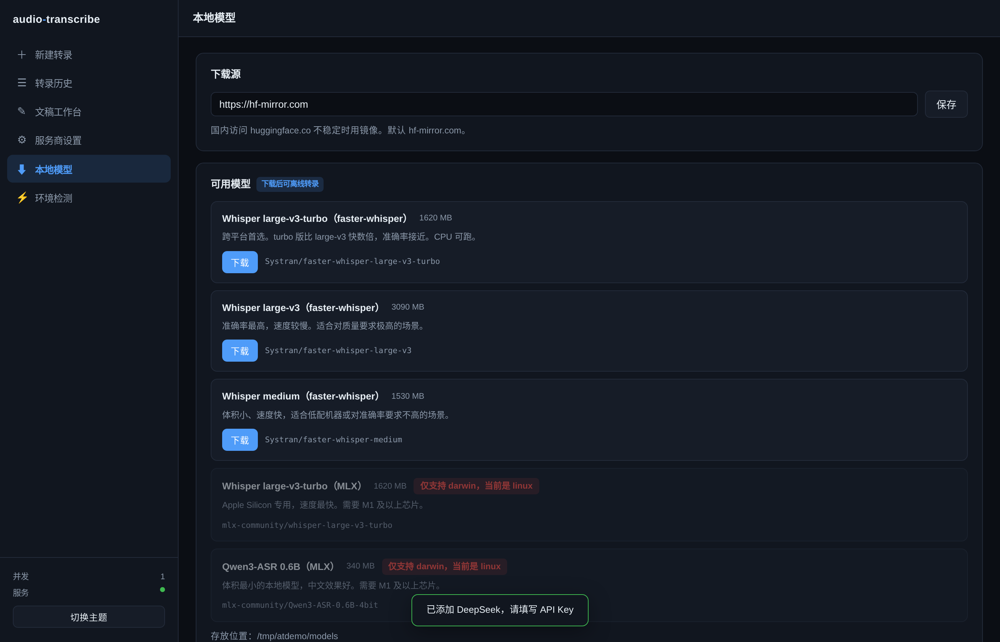

---

## 六、历史与在线编辑

所有任务都在「转录历史」里，状态、耗时、是否降级一目了然：

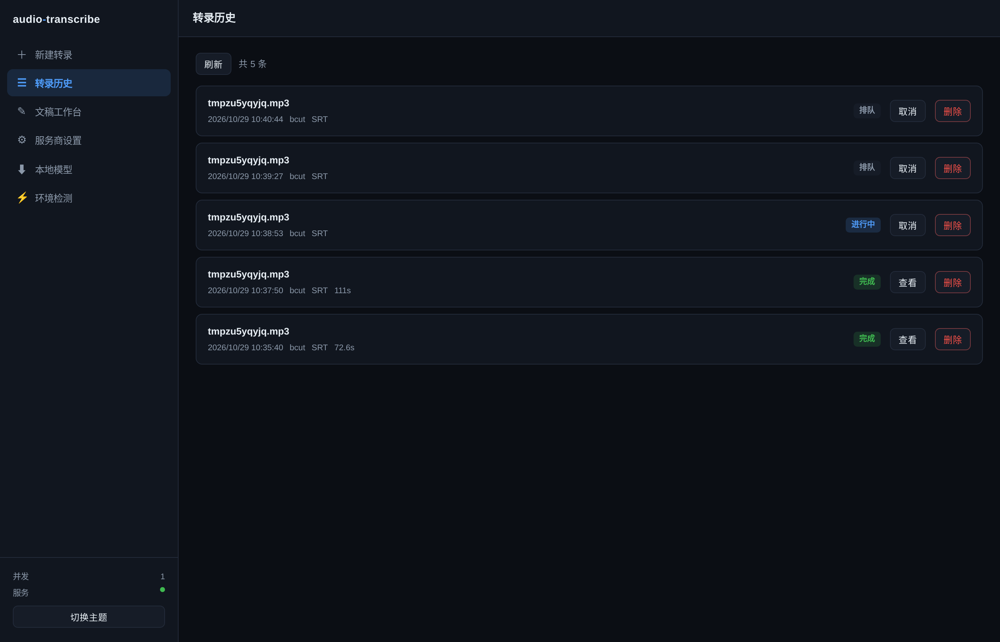

点「查看」进文稿工作台：

- **播放器 + 时间戳同步**：转录稿跟着音频滚动高亮当前句，点任意时间戳跳到该处
- **就地编辑**：直接改任意一句话，点「保存修改」写回
- **重新导出**：编辑后可导出 SRT / TXT，格式随时换
- **润色**：三档强度（轻度只去语气词 / 中度修正错字语病 / 重度整理为书面表达），结果并列显示**不覆盖原文**
- **总结**：一句话概括 + 核心要点 + 金句 + 行动项，尽量带时间戳
- **问答**：就这份文稿提问，答案带可点击的时间戳

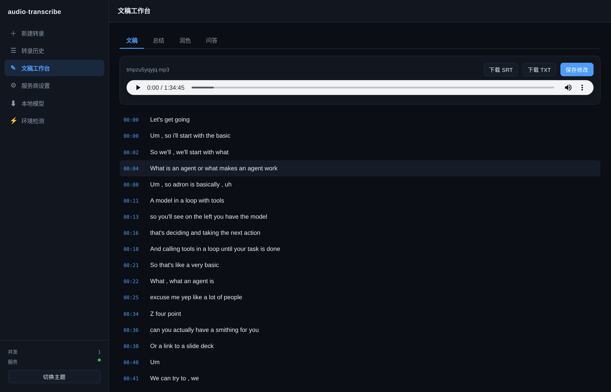

长文稿走 BM25 检索，回答里的时间戳可以直接点着跳转：

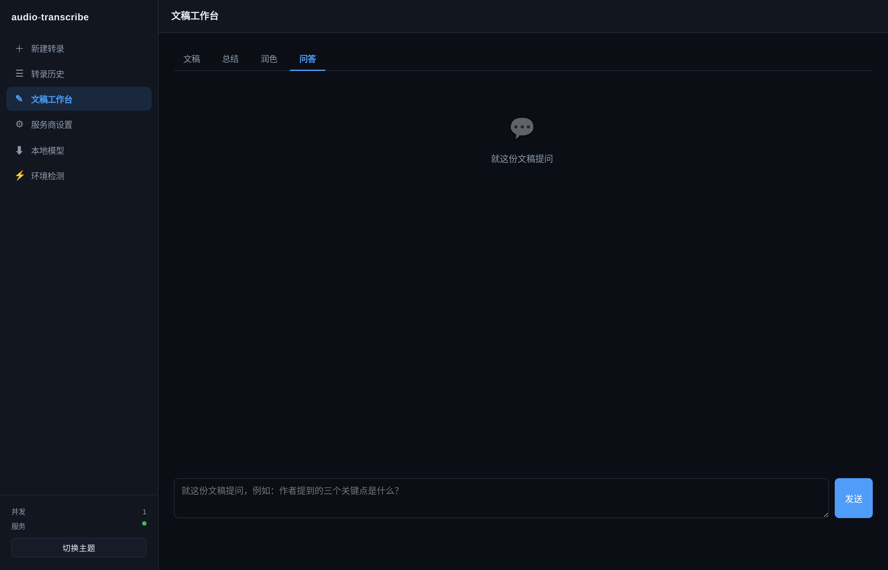

---

深浅两套主题，右上角切换，选择记在浏览器里：

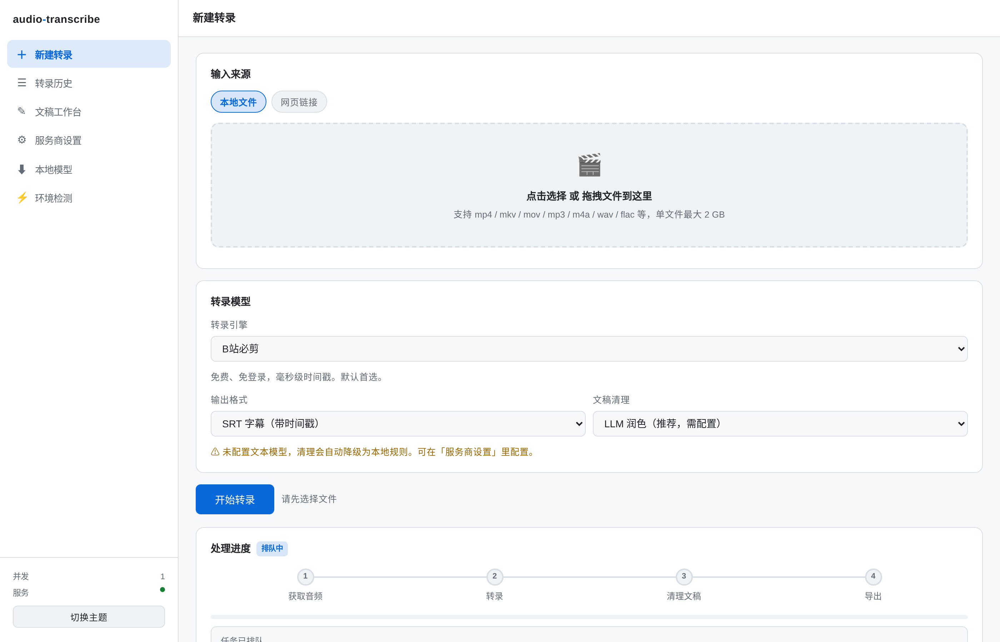

## 七、部署

### 本机（推荐）

```bash
python web/server.py
```

默认只听 `127.0.0.1`，别的机器连不上。

可选参数：

```bash
python web/server.py --port 9000        # 换端口
python web/server.py --concurrency 2    # 同时处理 2 个任务
python web/server.py --no-browser       # 不自动开浏览器
python web/server.py --host 0.0.0.0     # ⚠ 对外开放，见下方警告
```

### Docker

```bash
docker build -t audio-transcribe .
docker run --rm -p 127.0.0.1:8787:8787 -v at-data:/data audio-transcribe
```

注意 `-p 127.0.0.1:8787:8787`：**左边必须是 `127.0.0.1`**。写成 `-p 8787:8787` 会把端口暴露到局域网。

容器内监听 `0.0.0.0` 是正确的（容器网络与宿主隔离），暴露面由宿主机侧的端口绑定控制。

数据卷 `/data` 持久化任务历史、转录产物和下载的模型。

### ⚠ 关于对外暴露

这个工具**没有鉴权**。设计前提是"只给自己用"，所以默认只听回环地址。

如果你确实要让别的机器访问，务必自己加一层：SSH 端口转发（`ssh -L 8787:127.0.0.1:8787 host`）、Nginx Basic Auth、或 Cloudflare Tunnel + Access。不要把裸的 `--host 0.0.0.0` 直接挂公网——那等于把你的 API Key 使用额度和 Cookie 登录态交给所有人。

---

## 八、环境变量

| 变量 | 默认 | 说明 |
|---|---|---|
| `AUDIO_TRANSCRIBE_HOME` | `~/.audio-transcribe` | 数据目录（模型、产物、历史、静态二进制） |
| `AT_CONCURRENCY` | `1` | 并发任务数 |
| `AT_MAX_UPLOAD_MB` | `2048` | 单文件上传上限 |
| `HF_ENDPOINT` | `https://hf-mirror.com` | 模型下载源 |
| `OPENAI_API_KEY` | — | LLM 兜底 key（配了就不必在界面里填） |
| `OPENAI_BASE_URL` | — | LLM 兜底地址 |
| `SILICONFLOW_API_KEY` | — | 硅基流动转录 |
| `XHS_COOKIE` / `DOUYIN_COOKIE` / `KUAISHOU_COOKIE` | — | 平台 Cookie（也可在界面填） |

---

## 九、API 一览

想自己写脚本调的话：

| 方法 | 路径 | 说明 |
|---|---|---|
| GET | `/api/health` | 健康检查 |
| GET | `/api/env` | 环境检测结果 |
| POST | `/api/env/install` | 执行修复 |
| GET | `/api/engines` | 引擎列表与平台可用性 |
| GET | `/api/models` | 模型列表与下载状态 |
| POST | `/api/models/download` | 开始下载模型 |
| GET | `/api/models/{id}/progress` | 下载进度（SSE） |
| DELETE | `/api/models/{id}` | 删除模型 |
| POST | `/api/transcribe/url` | 提交链接转录 |
| POST | `/api/transcribe/file` | 提交本地文件转录（multipart） |
| GET | `/api/tasks` | 任务列表 |
| GET | `/api/tasks/{id}` | 任务详情 |
| GET | `/api/tasks/{id}/events` | 进度事件流（SSE） |
| POST | `/api/tasks/{id}/cancel` | 取消 |
| DELETE | `/api/tasks/{id}` | 删除任务及产物 |
| GET | `/api/tasks/{id}/content` | 全文 + 分段 |
| GET | `/api/tasks/{id}/download` | 下载产物（`?fmt=srt\|txt\|json`） |
| POST | `/api/tasks/{id}/save` | 保存在线编辑 |
| POST | `/api/llm/summarize` | 生成总结 |
| POST | `/api/llm/polish` | 润色 |
| POST | `/api/llm/chat` | 文稿问答 |
| POST | `/api/test/connection` | 测试服务商配置 |
| GET | `/api/audio/{id}` | 原始媒体（供播放器） |

所有 LLM/ASR 请求的 key 都走请求体，不读服务端配置。

---

## 十、常见问题

**界面打不开**
服务没起来。看终端报错，多半是 `fastapi` / `uvicorn` 没装：`pip install -r requirements-web.txt`。

**转录一直卡在"获取音频"**
链接类任务在下载。B站/YouTube 大文件可能要几分钟。超过 10 分钟建议取消，检查网络或改用本地文件。

**提示"清理已降级为本地规则"**
没配文本模型，或模型服务暂时不可用。转录结果**不会丢**，只是少了 LLM 润色。配好服务商再重跑，或直接用规则结果。

**B站链接报 `ArgsException: 尚未安装第三方请求库`**
`bilibili-api-python` 17.x 起不再自带请求库。去环境检测页点「修复」，或手动 `pip install curl_cffi`。

**上传大文件报 413**
超了 2 GB 上限。改 `AT_MAX_UPLOAD_MB`，或先用 ffmpeg 压一下。

**模型下载不动**
换下载源。页面上把 `hf-mirror.com` 改成别的镜像，或挂代理后用 `huggingface.co`。

**播放器没声音**
原始媒体在任务完成后默认保留，但用 `keep_media=false` 提交的、或手动删过上传目录的，就找不回来了。这时只能看文字稿。
